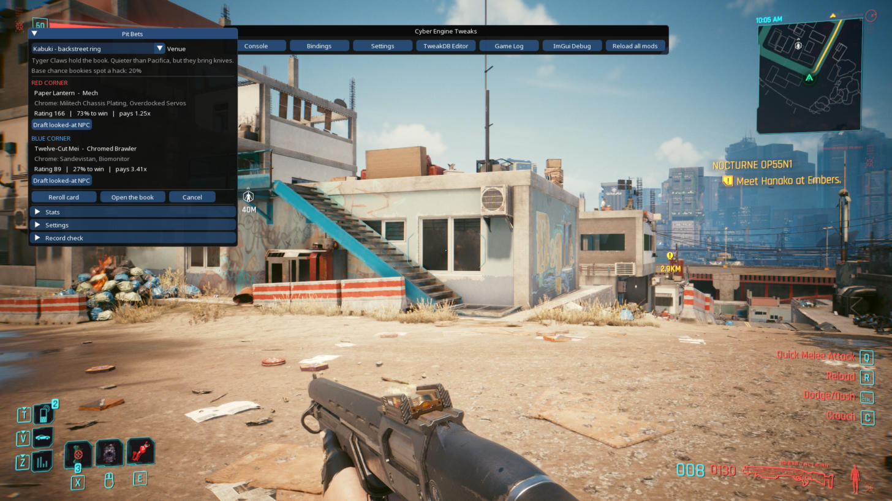
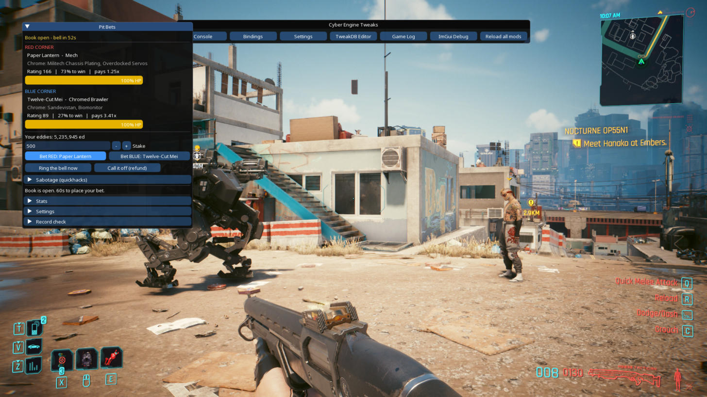
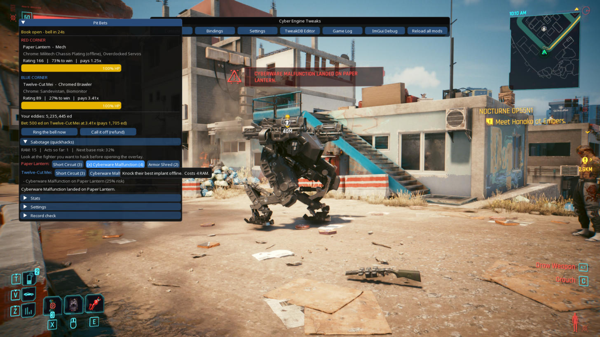
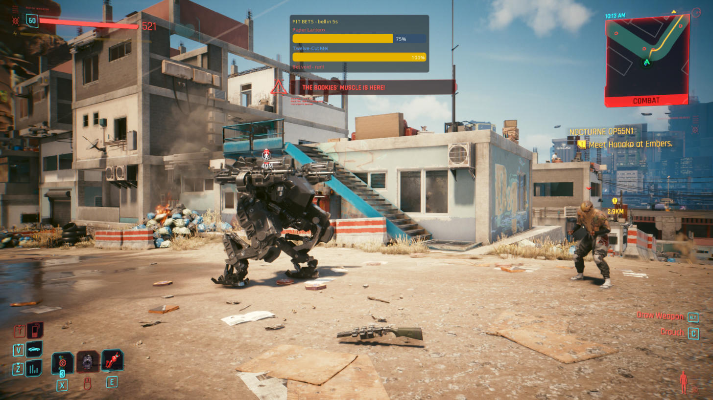
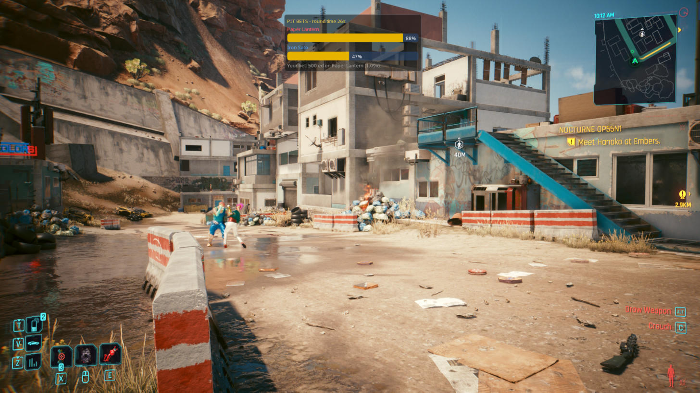
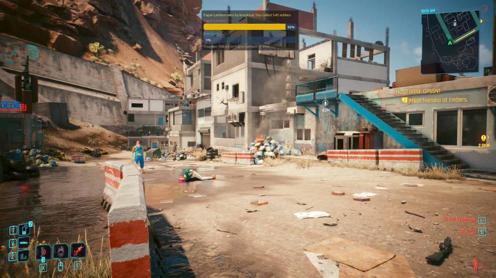

# Pit Bets

**[Download on Nexus Mods](https://www.nexusmods.com/cyberpunk2077/mods/36869)**

A Cyber Engine Tweaks mod for Cyberpunk 2077. Bet eddies on underground fights between NPCs in Pacifica and Kabuki: boxers, chromed brawlers, even mechs. Each fighter's cyberware sets their odds, and it also buffs them in the actual fight. You can sabotage a fighter with quickhacks before the bell, but if the bookies catch you, your bet is void and they come for you.



| | |
|---|---|
|  |  |
|  |  |



## Requirements

- Cyberpunk 2077 2.x (tested on 2.5 with CET, Codeware 1.21)
- [Cyber Engine Tweaks](https://www.nexusmods.com/cyberpunk2077/mods/107)
- [Codeware](https://www.nexusmods.com/cyberpunk2077/mods/7780) (spawns the fighters. Without it you can still draft fighters from the crowd.)

## Install

Extract the release zip into your game folder, or install it with Vortex / MO2. The mod goes in:

```
Cyberpunk 2077/bin/x64/plugins/cyber_engine_tweaks/mods/PitBets/
```

From source, run `powershell -ExecutionPolicy Bypass -File build.ps1` and use the zip in `dist/`, or copy the `PitBets` folder there yourself.

## How to play

1. Go somewhere open in Pacifica or Kabuki. Fighters spawn about 8 m in front of you.
2. Open the CET overlay. The **Pit Bets** window is there (bind a hotkey to hide or show it).
3. Pick a venue and press **Get tonight's card**. Reroll until you like the matchup.
   - **Draft looked-at NPC** puts whoever you're aiming at into a corner instead.
4. **Open the book.** The fighters walk out and the odds lock.
5. Place your bet before the bell, or ring it early.
6. Optional: **sabotage**. Look at a fighter and spend RAM:
   - *Short Circuit* (3 RAM): -25% health
   - *Cyberware Malfunction* (4 RAM): their best implant goes offline
   - *Armor Shred* (2 RAM): halves armor
   Your own cyberdeck quickhacks, shots and blade hits on a fighter count too, at most one act per fighter every 3 s. Bleed and burn ticks afterwards don't count. Every act can be spotted: Pacifica starts at 30%, Kabuki at 20%, and each act after that adds 12%.
7. A fight ends on a knockout, or goes to the judges (more health wins) after 120 s. A double KO refunds your stake.

If you get caught, your stake is gone. You get an 8-second warning, and then three of the bookie's gang spawn 25 m from the ring, hostile to you. Run or fight. They hit hard, so don't stand still in the overlay. If you flatline, the fight night ends.

Fighters stay neutral to V, so they fight each other and leave you alone, and you can still quickhack them. Hit one yourself and it will come after you.

**Drafting:** aim at any NPC and press **Draft looked-at NPC** to put them in a corner. They get a ring handle, and their game name shows as a label. Civilians usually run instead of fighting. A fighter who stays more than 25 m from the ring for 10 s forfeits. If both leave, it's a no-contest and your stake is refunded.

## How the odds work

Rating = class base (Boxer 40, Chromed Brawler 55, Mech 110, drafted NPC 25 + level) + implant ratings, multiplied by a ±10% form roll. Win chance is `rA^1.6 / (rA^1.6 + rB^1.6)`, capped at 90/10. Payout is `0.92 / p`, rounded down, so the house keeps an 8% edge.

Implants also apply real stat modifiers (max-health multiplier and armor). That pushes the actual fight toward the odds, but upsets happen.

## Hotkeys (set in CET > Bindings)

- **Toggle Pit Bets window**
- **Ring the bell**
- **Dump character records (modders)**: writes every character record ID to `PitBets/records_dump.txt`, for picking new fighters

## Customising

`PitBets/roster.lua` holds the fighters, cyberware, venues, bookies and handles. Each fighter template lists candidate TweakDB character records, and only the ones that exist in your game get used. The **Record check** section of the window shows which records loaded. To add NPC types, look up their record IDs in AMM or the WolvenKit Tweak Browser.

Stats and settings are saved in `PitBets/stats.json`.

## Known limits

- Fights happen wherever you're standing. There's no fixed arena location.
- The CET overlay doesn't pause the game. The world keeps going while you click.
- Mechs use quest records (`q114_militech_drop_mech`, `q003_militech_mech`). They're rare (about 1 card in 5) and heavy favourites. Don't fire a gun next to one: in testing, a mech once turned its miniguns on V after V shot the other fighter.
- Gunfire and combat draw in the local gang. On Valentinos turf they shot V while the bookies were already attacking.
- Fighters can wander a bit during a fight.
- The fight HUD stays visible in the pause menu.

## Development

The game logic runs outside the game against fake engine, ImGui and CET APIs:

```bash
luajit tests/run.lua
```

Layout:

| File | Role |
|---|---|
| `init.lua` | CET events, hotkeys, the OnHit hook, save/load |
| `pit.lua` | Fight-night state machine (idle → card → spawning → betting → fighting → result) |
| `engine.lua` | Every game API call, each wrapped in `pcall` |
| `roster.lua` | Data: fighters, cyberware, venues, sabotage |
| `odds.lua` | Odds, payouts, detection math |
| `ui.lua` | ImGui window and in-game HUD |
| `debug_tools.lua` | Record dump and the optional hit logger (`debug = true` in `init.lua`) |

Engine rule learned the hard way: never keep an entity handle across frames. Look fighters up by ID each time. A stale handle read during a save load crashes the game, and `pcall` can't catch that.

## License

MIT. See [LICENSE](LICENSE).
